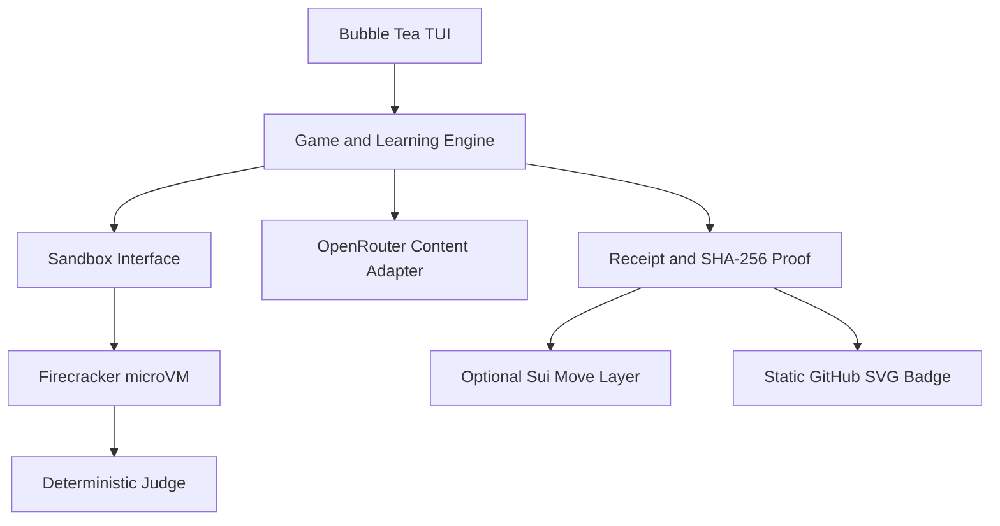

# GrepQuest — Research and Implementation Plan

Date: August 22, 2026
Status: Product and architecture draft
Working title: **GrepQuest**

## 1. Recommendation

The idea is strong and technically feasible. Its best product core is:

> A local terminal roguelite in which players solve real `grep` tasks inside a
> reproducible microVM, unlock visible equipment and skill stats, and optionally
> publish selected progress proofs on Sui.

The order of implementation matters:

1. Solving `grep` tasks must be fun first.
2. Character progression, loot, mastery, and repetition come next.
3. Then add microVM hardening and reproducible challenge packs.
4. Add blockchain, public leaderboards, and the GitHub badge only afterward.

Blockchain must not be the product core. It is the public proof and sharing
layer; the application itself remains local-first.

### Three important product decisions

- **AI never judges solutions.** The judge is deterministic and executes a
  pinned GNU `grep` version against test data. OpenRouter may generate story,
  item names, visual variations, and personalized exercise variants.
- **Not every loot drop goes onchain.** Ordinary items stay local. Only
  milestones, season results, and voluntary loadout snapshots are published.
- **An OpenRouter key is not required for the first run.** The core tutorial
  works offline. `OPENROUTER_API_KEY` enables personalized AI runs and unique
  loot. Requiring a key would unnecessarily reduce open-source adoption.

## 2. Research: Existing projects

Several adjacent projects exist, but none convincingly combines serious
`grep` learning, a microVM, RPG progression, and public skill proofs:

| Project | Existing strengths | Gap addressed by GrepQuest |
|---|---|---|
| [learnbyexample: GNU grep/ripgrep](https://github.com/learnbyexample/learn_gnugrep_ripgrep) | Many examples, exercises, and an interactive TUI | Little RPG progression, no isolated VM, and no public skill profile |
| [ShellQuest](https://github.com/tcsenpai/shellquest) | Extensible open-source terminal escape room | Broad Linux scope rather than deep, measurable `grep` mastery |
| [gh-dungeons](https://github.com/leereilly/gh-dungeons) | Roguelike generated from a repository and Git SHA | Primarily a game built from code, not structured `grep` mastery |
| [interactive grep/sed/awk exercises](https://learnbyexample.github.io/interactive-grep-sed-awk-exercises/) | Practical existing exercises | No shared character, loot, proof, or season system |

### Positioning consequence

Position the project as:

> **Proof-of-Skill Roguelite for search mastery.** Learn GNU grep by raiding
> reproducible Linux environments.

The same engine could later support `sed`, `awk`, `find`, `jq`, `rg`, and
network or security CLI tools. The first release deliberately covers only
`grep`.

## 3. Learning and gameplay principles

### Core loop: 5–12 minutes

1. The player enters a room with a concrete situation such as compromised
   logs, a broken configuration, or a large source archive.
2. The TUI shows the objective, file tree, known hints, and player character.
3. The player writes a real `grep` command.
4. The microVM executes it in a disposable challenge environment.
5. A deterministic judge evaluates output, exit status, and allowed solution
   constraints.
6. Immediate feedback explains both correctness and the relevant `grep`
   semantics.
7. The player receives XP, mastery, a drop, or crafting material.
8. Weak skills are tested again later through spaced retrieval.

### Engagement without dark patterns

The goal is voluntary return, not manipulative dependency. Suitable mechanics
include:

- short runs and visible progress;
- random cosmetic drops with bad-luck protection;
- collections and set bonuses as visualization rather than paid advantages;
- a Daily Expedition with the same public seed for everyone;
- personal bests and friend groups instead of only a global top ten;
- mastery retests after 1, 3, 7, and 21 days;
- “one more room” choices at clear natural stopping points;
- no real-money loot boxes or tradable token in the MVP.

Retrieval practice matters more for learning than passive repetition. Players
should actively recall options and patterns rather than only rereading a cheat
sheet. Leaderboards, badges, progress, and challenges can support competence,
but must not substitute for it.

## 4. Curriculum

### Act I — The Signal Cellar

- simple patterns;
- standard input versus files;
- case-insensitive matching with `-i`;
- fixed strings with `-F`;
- whole words and lines with `-w` and `-x`;
- exit statuses 0, 1, and error cases.

### Act II — The Regex Foundry

- BRE versus ERE;
- `-E`;
- anchors `^` and `$`;
- character classes;
- repetition and quantifiers;
- groups and alternation;
- escaping and shell quoting.

### Act III — The Recursive Wilds

- recursive search with `-r` and `-R`;
- `--include`, `--exclude`, and `--exclude-dir`;
- file-name output with `-l` and `-L`;
- symlinks and recursive edge cases;
- binary files and forcing text mode.

### Act IV — The Context Vault

- line numbers and file names;
- `-A`, `-B`, and `-C`;
- match-only output with `-o`;
- counting with `-c`;
- inverted selection with `-v`;
- multiple patterns with `-e` and pattern files with `-f`.

### Act V — The Production Ruins

- realistic logs, configurations, and source trees;
- locale effects and `LC_ALL=C`;
- large files and bounded output;
- safe handling of unusual file names;
- comparison of GNU grep, BSD grep, and optionally `ripgrep`;
- performance only where it can be measured semantically and fairly.

### Act VI — Pipeline Arena, after the core MVP

- `grep` in pipelines;
- interaction with `find`, `xargs`, `sort`, `uniq`, `cut`, and `head`;
- NUL delimiters and robust file-name handling;
- process and exit-status behavior in shell pipelines.

The VM pins a specific GNU `grep` version so that tasks, output, and rules are
reproducible across host operating systems.

## 5. Character, equipment, and stats

### Visual model

The character remains compact, terminal-native, and easy to share. Example
slots include:

- Head: Pattern Lens;
- Tool: Recursive Compass;
- Body: Context Mantle;
- Charm: Exit-Code Sigil;
- Relic: ERE Codex.

Each item has:

- a deterministic item ID;
- rarity and slot derived from game rules;
- a small validated ASCII or Unicode sprite;
- an AI-generated name and flavor text;
- a link to an actually mastered `grep` skill;
- the hash of its source challenge pack.

### Meaningful stats

| Public stat | Actual meaning |
|---|---|
| Signal | Share of hidden tests solved correctly |
| Pattern | BRE and ERE mastery |
| Range | Recursion, includes, and excludes |
| Context | Context and output control |
| Discipline | Solving with few or no hints |
| Recall | Success in delayed retests |

Equipment visualizes ability. It must not improve scoring artificially, or the
leaderboard would measure items rather than `grep` skill.

## 6. Target architecture



### Host application

- Go;
- Bubble Tea v2 for the state model and event loop;
- Bubbles v2 for text input, viewport, tables, progress, and help;
- Lip Gloss v2 for responsive layout and color levels;
- local SQLite for progress, AI cache, receipts, and offline inventory;
- a Nix flake for reproducible development and release builds.

[Bubble Tea](https://github.com/charmbracelet/bubbletea) is MIT-licensed, uses
the Elm Architecture, and is suitable for full-window TUIs. The v2 family uses
the import paths `charm.land/bubbletea/v2`, `charm.land/bubbles/v2`, and
`charm.land/lipgloss/v2`.

### Why the host TUI and guest judge are separate

- The TUI stays responsive and does not render inside a VM.
- The OpenRouter key remains exclusively on the host.
- The guest has no network access.
- Players can execute real commands without touching the host filesystem.
- Sandbox backends can be replaced later.

### Sandbox interface

Define a small interface from the beginning:

```go
type Sandbox interface {
    Boot(ctx context.Context, challenge ChallengeInstance) error
    Run(ctx context.Context, command string) (ExecutionResult, error)
    Reset(ctx context.Context) error
    Close(ctx context.Context) error
}
```

Backends:

1. `native`: fast development and testing only;
2. `firecracker`: primary Linux/KVM backend;
3. `qemu-microvm`: later compatibility option;
4. `mock`: UI and engine tests.

This avoids coupling the entire application to Firecracker before gameplay is
validated.

## 7. MicroVM design

Firecracker uses KVM, a deliberately small emulated device surface, seccomp
filters, and an optional jailer with cgroups, namespaces, and privilege drop.
It suits small disposable challenge VMs but requires Linux and `/dev/kvm`, so
the MVP should be Linux-first.

### Guest image

- reproducible kernel and root filesystem artifacts built with Nix;
- read-only root filesystem;
- a pinned GNU grep version;
- a small static guest agent;
- `tmpfs` for challenge files and the player home;
- no network devices;
- no host shares;
- communication only through vsock or virtio-serial;
- 1 vCPU and 128–256 MiB RAM;
- strict time, process, and output limits.

### Privilege separation in the guest

- `judge`: privileged control process, unreadable by the player;
- `player`: unprivileged account for submitted commands;
- challenge tree readable by `player`, writable only where required;
- answer data and hidden-test metadata absent from the player directory;
- every run ends through timeout or controlled process termination;
- reset the VM or restore a clean snapshot after each run.

### Command modes

- MVP: exactly one `grep` invocation passed safely as argv, without free shell
  evaluation;
- later: Pipeline Arena with a minimal shell inside the VM;
- guest limits plus a host timeout terminate fork bombs and infinite processes.

## 8. Challenge and judge model

A challenge pack is a versioned, canonically serialized directory:

```text
packs/core/v1/
├── pack.json
├── challenges/
│   ├── literal-001.json
│   ├── ere-001.json
│   └── recursive-001.json
├── fixtures/
├── schemas/
└── LICENSE
```

### Challenge specification

- ID and curriculum tags;
- difficulty;
- seed rules for fixture generation;
- visible objective;
- allowed command mode;
- reference semantics;
- multiple hidden-test seeds;
- normalization rules;
- hint levels;
- scoring weights;
- pack and challenge hashes.

### Evaluation

Depending on the task, the judge compares:

- exact bytes and ordering;
- normalized lines;
- sets of matches;
- exit status;
- expected files;
- forbidden or required semantics only when the lesson requires them.

Do not blindly reward the shortest command. Brevity is not a reliable quality
signal. Global rankings should not primarily use execution time because local
hardware and automation easily distort it.

### Example score

```text
score = base_points
      + hidden_test_bonus
      + no_hint_bonus
      + delayed_recall_bonus
      - failed_attempt_penalty
```

The formula belongs to the hashed season ruleset.

## 9. OpenRouter and AI content

OpenRouter is suitable as a bring-your-own-key layer because the application
does not need to operate its own model gateway. Structured Outputs can enforce
a fixed JSON schema, while Zero Data Retention endpoints and
`data_collection: deny` can be required.

### What AI may generate

- item names;
- flavor text;
- small visual item variants;
- mission framing and NPC text;
- personalized explanations after an incorrect solution;
- variants derived from validated challenge templates;
- Daily Expedition themes.

### What AI never controls

- correctness;
- XP or rarity;
- pack hashes or receipts;
- leaderboard rank;
- executable host commands;
- wallet transactions;
- paths outside a challenge schema.

### Security rules

- read `OPENROUTER_API_KEY` only in the host process;
- never copy it into guest environments, logs, receipts, or crash dumps;
- explicitly minimize child-process environments;
- validate AI responses strictly against JSON Schema;
- remove ANSI, OSC, control, and escape sequences;
- enforce maximum text and sprite sizes;
- hash the prompt, model, schema, and generator version;
- cache results locally so identical loot does not incur repeated cost;
- configure per-session and per-day budgets;
- provide built-in fallback loot.

### Product decision on API keys

Recommended behavior:

- `grepquest play` works without a key using core packs;
- `grepquest ai enable` requires `OPENROUTER_API_KEY`;
- AI loot and personalized daily runs make the optional value visible.

## 10. What is possible without a custom server

“No custom server” is possible. “No hosting or external infrastructure” is not:
Sui nodes store state, public RPC or GraphQL services return data, OpenRouter
runs models, and GitHub serves badges.

### Practical options

| Variant | Custom backend | Global board | Tamper resistance | Recommendation |
|---|---:|---:|---:|---|
| Local only plus static SVG | No | No | Locally self-attested | First prototype |
| Sui events plus public GraphQL RPC | No | Yes, calculated client-side | Self-attested | MVP social layer |
| GitHub Actions verifier plus Sui | No | Yes | Reproducible and CI-signed | Best serverless public beta |
| Custom verifier and indexer | Yes | Yes | Strongest | Only after real growth |

### Why blockchain alone does not prevent cheating

A SHA-256 digest proves that data did not change after hashing. It does not
prove that a run was honest. A local client can be patched. A wallet signature
proves who signed data, not whether the data is true.

Proof tiers are therefore required:

1. **Local / self-attested:** receipt digest plus wallet signature;
2. **CI-verified:** a reproducible GitHub workflow replays and signs the result;
3. **Official / competitive:** a later independent verifier, TEE, or suitable
   zero-knowledge approach.

A zero-knowledge proof for unchanged execution of a real GNU `grep` binary is
far too complex and expensive for the MVP.

## 11. Recommended Sui Move model

Sui fits because profiles, achievements, and items map naturally to objects.
Dynamic fields support extensible profile data, while derived objects avoid a
shared hotspot for independent player entries. Events can be queried through
GraphQL, subject to public endpoint rate and complexity limits.

### Onchain objects

```text
Season
  season_id
  pack_sha256
  rules_sha256
  start_epoch / end_epoch

PlayerProfile
  owner
  mastery_bitmap
  level
  best_season_score
  latest_receipt_sha256
  proof_tier

Achievement
  owner
  achievement_type
  season_id
  receipt_sha256

LoadoutSnapshot
  owner
  item_ids_or_hashes
  stats_hash
  receipt_sha256
```

### Write strategy

- store each challenge locally;
- offer a bundled onchain commit after a boss, division promotion, or session;
- emit a `ScoreSubmitted` event;
- retain only the best confirmed result per player and season in the profile;
- calculate boards client-side from events or player profiles;
- avoid a single central mutable top-100 shared object in the initial design.

### Gas and onboarding

Without a sponsor service, players pay Sui fees. Sponsored transactions reduce
that hurdle but require funded gas and a service or policy component. Therefore:

- local play and the tutorial require no wallet;
- use Testnet for the first public beta;
- make Mainnet opt-in;
- add sponsorship only after usage justifies the operational cost;
- evaluate passkeys or existing wallets later for easier signing.

Publish Move package sources and verify them against onchain bytecode with
Sui's source-verification mechanism.

## 12. Leaderboards

A single worldwide leaderboard discourages beginners and rewards cheating.
Prefer:

- Season Mastery;
- Daily Expedition;
- friends and GitHub follows;
- divisions: Scout, Hunter, Ranger, and Archivist;
- strict separation of verified and self-attested results;
- categories for accuracy, recall, and no-hint clears;
- speed only as a separate hardware-dependent category.

The client reads `ScoreSubmitted` events through Sui GraphQL, filters by season
and proof tier, and calculates ranking locally. This works for a small community
without a custom indexer. Large event volumes require an indexer or external
data provider.

## 13. GitHub badge without a badge server

GitHub has no freely designed native profile-banner slot; in practice, use the
profile README, which can embed images and SVGs.

### Recommended solution: static signed SVG in the profile repository

```text
timfewi/timfewi
├── README.md
└── assets/
    ├── grepquest.svg
    └── grepquest-proof.json
```

Example content:

```text
GREPQUEST · LV 17 · ERE 82 · VERIFIED · #a31f9c2d
```

The SVG may show a small character and equipped relic. The short SHA-256 prefix
links to the complete receipt or Sui explorer.

### Update flow

1. `grepquest badge render` generates SVG and proof JSON locally.
2. After explicit confirmation, the player copies them into the profile repo.
3. The player commits manually or deliberately invokes `gh`.
4. An optional GitHub Actions workflow can query public Sui GraphQL and commit
   an updated SVG.
5. All GitHub Actions are pinned to complete commit SHAs.

Shields.io supports static and dynamic badges. A live blockchain value would
need a compatible public JSON endpoint, so an SVG stored in the profile repo is
simpler, more visual, and requires no custom endpoint.

## 14. Receipt format

A canonical receipt should contain at least:

```json
{
  "receipt_version": 1,
  "player_address": "0x...",
  "season_id": "season-2026-01",
  "pack_sha256": "...",
  "rules_sha256": "...",
  "client_build_sha256": "...",
  "challenge_results_sha256": "...",
  "score": 4280,
  "mastery": {
    "literal": 91,
    "ere": 82,
    "recursive": 76,
    "context": 88
  },
  "proof_tier": "self",
  "created_at": "...",
  "receipt_sha256": "...",
  "signature": "..."
}
```

Calculate the receipt digest from a canonical serialization that excludes
`receipt_sha256` and the signature. Do not rely on ordinary Go JSON marshaling
or assumed map ordering; use a defined canonical JSON or BCS schema.

## 15. Repository structure

```text
grepquest/
├── cmd/grepquest/
├── internal/
│   ├── app/
│   ├── tui/
│   ├── game/
│   ├── learning/
│   ├── judge/
│   ├── sandbox/
│   │   ├── native/
│   │   ├── mock/
│   │   ├── firecracker/
│   │   └── qemu/
│   ├── ai/openrouter/
│   ├── proof/
│   ├── chain/sui/
│   ├── badge/
│   └── storage/
├── guest/
│   ├── agent/
│   ├── init/
│   └── image/
├── packs/core/v1/
├── move/grepquest/
├── schemas/
├── nix/
├── .github/workflows/
├── flake.nix
├── go.mod
├── LICENSE
├── THIRD_PARTY_NOTICES.md
└── SECURITY.md
```

Project-owned Go code can use MIT. Bubble Tea uses MIT and Firecracker uses
Apache-2.0. GNU grep remains independently licensed under the GPL. Distribution
of a guest image must satisfy every bundled component's source and notice
obligations; VM contents do not become MIT-licensed as a whole.

## 16. Security model

### Assets

- host filesystem and SSH, Git, or cloud credentials;
- `OPENROUTER_API_KEY`;
- Sui wallet keys;
- challenge-pack and receipt integrity;
- terminal safety;
- GitHub access during badge installation.

### Rules

- no guest network by default;
- no host-directory mounts;
- verify root filesystem and challenge-pack SHA-256 digests;
- sign release artifacts using GitHub artifact attestations;
- treat OpenRouter output as untrusted;
- never render unsanitized AI terminal escapes;
- display complete wallet transactions and request separate confirmation;
- never commit a badge without explicit user action;
- disclose Move package and upgrade-capability custody;
- reference immutable seasonal rules by digest;
- pin external Actions to commit SHAs.

## 17. Implementation plan

### Phase 0 — Product spike, 2–3 days

Deliverables:

- working name and visual direction;
- ten hand-written `grep` challenges;
- deterministic native judge behind the sandbox interface;
- simple Bubble Tea view;
- three test players.

Exit criteria:

- at least two of three players voluntarily want another run;
- every task produces reproducible judgments;
- errors are explained better than by only showing a sample solution.

### Phase 1 — Playable core, 5–7 days

- three TUI panels: Mission, Terminal, and Character;
- local profiles and mastery in SQLite;
- 25 challenges from Acts I and II;
- hint levels;
- XP, levels, and ten built-in loot items;
- snapshot tests for UI and judge behavior.

### Phase 2 — MicroVM, 7–10 days

- Firecracker adapter;
- reproducible guest image;
- vsock or virtio-serial protocol;
- read-only root filesystem, `tmpfs`, and no NIC;
- time, RAM, CPU, process, and output limits;
- image-digest verification;
- native backend retained only for development.

### Phase 3 — AI loot and personalization, 4–6 days

- OpenRouter adapter;
- Structured Output schema;
- ZDR and data-collection configuration;
- AI cache and budget limits;
- control-character sanitizer;
- personalized explanations and item skins;
- reliable offline fallback.

### Phase 4 — Proof and GitHub badge, 4–6 days

- canonical receipt;
- SHA-256 and local signature;
- SVG with character and loadout;
- proof JSON;
- documented manual profile README flow;
- optional minimally authorized GitHub Actions workflow.

### Phase 5 — Sui Testnet social layer, 7–10 days

- Move package and tests;
- `Season`, `PlayerProfile`, `Achievement`, and `ScoreSubmitted` event;
- client-side GraphQL queries;
- separate self-attested and verified rankings;
- explicit wallet and transaction confirmation;
- source verification of the published package.

### Phase 6 — Public beta, 5–7 days

- 75–100 reviewed challenges;
- Linux x86-64 release and Nix installation path;
- threat model, security policy, and third-party notices;
- signed release artifacts;
- onboarding under five minutes;
- playtest with at least 15 external participants.

### Realistic schedule

- convincing first prototype: **7–10 days**;
- public Linux beta: **5–7 weeks** of focused work;
- credible verified competitive system: another **2–4 weeks**.

Building blockchain support in week one would be overengineering. The project
succeeds or fails on the learning and loot loop.

## 18. MVP scope

### Required

- Linux and NixOS first;
- Go plus Bubble Tea v2;
- 25–40 high-quality `grep` challenges;
- deterministic judge;
- sandbox interface and Firecracker backend;
- character with five slots;
- local stats and loot;
- optional OpenRouter mode;
- static SVG badge with receipt digest;
- MIT codebase with correct third-party notices.

### Deliberately excluded

- real money or a custom token;
- tradable loot boxes;
- mandatory Mainnet use;
- custom indexer;
- custom web service;
- mobile client;
- first-class Windows and macOS support;
- zero-knowledge proofs for GNU grep;
- unreviewed community levels;
- multiple CLI tools at once.

## 19. Success metrics

Without a custom telemetry backend, collect these initially through moderated
tests and optional local exports:

- at least 70% complete the ten-room tutorial;
- at least 40% start three sessions within one week;
- median session length between 8 and 15 minutes;
- at least 80% pass a delayed retest of a learned flag;
- fewer than 10% of tasks are reported as ambiguous;
- at least 20% of active testers voluntarily export a badge;
- no OpenRouter request affects deterministic evaluation.

## 20. Major risks and mitigations

| Risk | Consequence | Mitigation |
|---|---|---|
| Blockchain before gameplay | Technically interesting, but nobody plays | Add onchain support only after validating the core loop |
| AI-generated ambiguity | Frustration and incorrect learning | Use validated templates and a deterministic judge |
| Patched local client | Fake scores | Proof tiers, CI verification, and no false “trustless” claims |
| KVM unavailable | Broken onboarding | Clear preflight, native demo, and later QEMU fallback |
| Mandatory key and wallet | Excessive first-run friction | Keep both optional and reveal value progressively |
| Terminal injection through AI | Host manipulation or phishing | Strip control characters and enforce renderer limits |
| Global leaderboard discourages beginners | Lower return rate | Divisions, friends, mastery, and daily boards |
| GNU/BSD semantic drift | Non-reproducible solutions | Pin GNU grep in the guest and hash pack versions |
| RPC limits | Slow boards | Pagination and caching, then an external indexer at scale |
| License errors in the VM image | Release risk | SBOM, notices, and source offers for guest components |

## 21. Final architecture assessment

The best version of this idea is neither a blockchain game nor an AI tutor that
freely invents commands. It is a local, reproducible skill engine with three
strictly separated layers:

1. **Learning truth:** pinned GNU grep, challenge pack, and deterministic judge;
2. **Engagement:** Bubble Tea roguelite, character, loot, mastery, and OpenRouter
   personalization;
3. **Public proof:** receipt, SHA-256, optional Sui, and GitHub SVG.

This separation keeps the project secure, testable, and extensible. If the
`grep` MVP succeeds, the same engine can grow into a broader CLI mastery
platform.

## 22. Primary sources and technical references

- [Bubble Tea repository and documentation](https://github.com/charmbracelet/bubbletea)
- [Bubbles components](https://github.com/charmbracelet/bubbles)
- [Lip Gloss](https://github.com/charmbracelet/lipgloss)
- [Firecracker overview](https://github.com/firecracker-microvm/firecracker)
- [Firecracker security design](https://github.com/firecracker-microvm/firecracker/blob/main/docs/design.md)
- [Firecracker production host setup](https://github.com/firecracker-microvm/firecracker/blob/main/docs/prod-host-setup.md)
- [GNU grep](https://www.gnu.org/software/grep/)
- [OpenRouter Structured Outputs](https://openrouter.ai/docs/guides/features/structured-outputs)
- [OpenRouter Zero Data Retention](https://openrouter.ai/docs/guides/features/zdr)
- [OpenRouter provider routing](https://openrouter.ai/docs/guides/routing/provider-selection)
- [Sui Dynamic Fields](https://docs.sui.io/develop/objects/dynamic-fields)
- [Sui Derived Objects](https://docs.sui.io/develop/objects/derived-objects)
- [Sui GraphQL RPC](https://docs.sui.io/develop/accessing-data/graphql/query-with-graphql)
- [Sui Sponsored Transactions](https://docs.sui.io/develop/transaction-payment/sponsor-txn)
- [Sui Passkeys](https://docs.sui.io/develop/cryptography/passkeys)
- [Sui Source Verification](https://docs.sui.io/develop/manage-packages/source-verification)
- [GitHub workflow badges](https://docs.github.com/actions/managing-workflow-runs/adding-a-workflow-status-badge)
- [GitHub artifact digests and attestations](https://docs.github.com/en/actions/concepts/workflows-and-actions/workflow-artifacts)
- [Shields.io static badges](https://shields.io/badges)
- [Shields.io endpoint badges](https://shields.io/badges/endpoint-badge)
